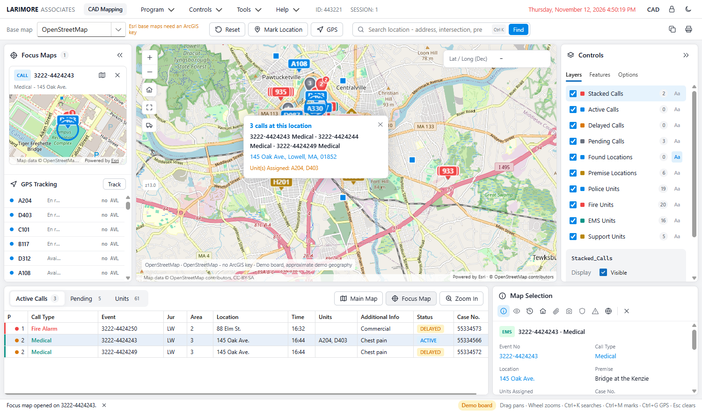

# LwCadMapping.Web: LW CAD Mapping on the web

This is a Blazor Server app (.NET 10, DevExpress Blazor 26.1.4). It has the screens and functions of the WPF
mock-up `Apps\LwCadMappingUX`, but on a real ESRI map (ArcGIS Maps SDK for JavaScript 5.1) and with real CAD calls
and units read through `LwCad.Core`.

**The app is read only.** It calls `ICadDataService.Refresh()` and the collection getters, and nothing else. It never
calls Dispatch, ApplyUnitChange, SelfInitiate, ActivateUnit, AssignUnits or any alert write. That makes it safe to
run against the live tables.



More screenshots: `..\Docs\cad-mapping-dark.png` (GPS simulation and a route) and `..\Docs\cad-mapping-live.png`
(the local development Lowell database, read only).

## Run

```powershell
cd C:\Development\Git\Mass\LW\Web
$env:CadMapping__Demo = "true"; dotnet run --project LwCadMapping.Web     # demo board
Remove-Item Env:CadMapping__Demo; dotnet run --project LwCadMapping.Web  # live CAD through La.cfg (read only)
```

The app runs on http://localhost:5182 and https://localhost:7195 (`Properties\launchSettings.json`). The browser
needs internet access to `js.arcgis.com` (the SDK) and to the basemap tiles.

## Configuration (`CadMapping` section)

| Setting | Purpose |
|---|---|
| `Demo` | `true` sets `CadHost.ForceDemoBoard`, so the app uses the demo board and skips the database. |
| `LaCfgPath` | Sets `LaGetConfig.OverridePath`. `appsettings.Development.json` points at `C:\Development\Git\Mass\LW\Development\La.cfg`. |
| `AgencyId`, `Extents` | The initial and full extent, as `[xmin, ymin, xmax, ymax]` in WGS84. LW is `[-71.382294, 42.601802, -71.231232, 42.669491]`. |
| `ArcGisApiKey` | **Secret. Set it only in user secrets or an environment variable.** It turns on ArcGIS basemap styles, geocoding and routing. |
| `GeocodeUrl`, `RouteUrl` | The ArcGIS World geocoder and route services. |
| `RefreshSeconds` | How often the server re-reads the CAD monitors (default 5). One poll serves every user. |
| `DefaultCity`, `DefaultState`, `DefaultZip` | Added to a CAD location before it is geocoded, and used in the callout's address line. |
| `OperationalLayers` | Replacements for the desktop LocalServer `.mpk` layers: `{ "Title", "Url", "Type": "feature\|map-image\|vector-tile\|tile", "Visible", "MinScale" }`. They are listed on the Features tab. |

### Adding the ArcGIS key

The project uses the spike's `UserSecretsId` (`lwcadmapping-web-7d3f1c2a`), so its secrets carry over. The spike's
`CadMap:ArcGisApiKey` is also read as a fallback. At the time of writing, that secret store had no ArcGIS key.

```powershell
cd C:\Development\Git\Mass\LW\Web\LwCadMapping.Web
dotnet user-secrets set "CadMapping:ArcGisApiKey" "<key scoped to basemaps + geocoding + routing>"
```

In production, use the environment variable `CadMapping__ArcGisApiKey` instead. The key is sent to the browser,
because the basemaps and routing run there, so restrict it by referrer. The server sends it to the geocoder in a
POST body, never in a URL, so request logging cannot capture it, and the app never logs it.

## Architecture

```
Browser                                        Server (Blazor Server)
  cadmap.js  <── JS interop ──  CadMap (IMapView)  <──  MappingSession (per circuit)  <──  CadBoard (singleton poller)
  ArcGIS JS 5.1 (CDN)                                         │                               │ Refresh() every RefreshSeconds
  shell.js (shortcuts, theme)                                 └── LocationService ──┐          ▼
                                                                                     ├── ArcGisLocator (World geocoder, cached)
                                                                                     └── demo geography (no key / demo)
                                                              LwCad.Core: CadDataServiceFactory -> SqlCadDataService | DemoCadDataService
```

- **`CadBoard`** (`Services\CadBoard.cs`) is a hosted singleton. It opens the back end with
  `CadDataServiceFactory.Create`, then calls `Refresh()` on its own loop. Only that loop touches the Core service.
  After each read it copies calls and units into immutable records (`MapCall`, `MapUnit`), locates them, and
  publishes a `BoardSnapshot` if anything changed. Circuits subscribe and apply the snapshot with `InvokeAsync`.
  Tools > Load Units asks for an immediate re-read, which is still only a read.
- **`MappingSession`** (`State\MappingSession.cs`) ports the mock-up's `ShellViewModel`: menu, toolbar, layers,
  options, selection, focus maps, simulated GPS, route and the Esc chain. There is one per circuit, and it moves
  the map only through `IMapView`.
- **`IMapView`** (`State\MapModels.cs`) is ADR-007's seam: show call, show units, select and centre, zoom, full
  extent, fit, mark, snapshot, copy and print, plus the drawing calls. It is async because every call goes to the
  browser. **`CadMap`** (`Components\Map\CadMap.razor`) implements it over `wwwroot\js\cadmap.js`.
- **`cadmap.js`** holds all the ArcGIS code. It loads the SDK from `https://js.arcgis.com/5.1/` (a module script in
  `App.razor`) and gets core classes with `$arcgis.import("@arcgis/core/...")`. There is one `MapView` with a
  `GraphicsLayer` per legacy overlay id (`Stacked_Calls` ... `Support_Units`, `Found_Locations`), plus feature, route,
  label and selection layers. The callout and coordinate box are DOM overlays positioned by the view. Focus maps
  are extra `MapView`s on the same `Map`, so they show the same layers live. No npm build step is needed.
- **Geocoding.** CAD leaves the STK1 X/Y coordinates at 0, and Core does not expose them, so every call location is
  geocoded on the server:
  - With a key: ArcGIS World geocoder, `forStorage=true`, cached for 7 days (misses for 10 minutes). Calls it cannot
    find are listed in the monitor but not drawn, and the monitor shows "N not located".
  - Without a key, or on the demo board: the mock-up's `DemoGeography` and `LocationSearch` (Lowell demo streets),
    labelled "approximate demo geography". An address the demo street file does not know is placed at a stable
    spot on a named demo street.
- **Units.** Lowell has no AVL feed (ADR-007), so each unit is drawn at its call when it has one, otherwise at its
  location or station. The callout says which. GPS tracking is the mock-up's simulation (en-route units drive to
  their calls), it runs only on the demo board, and it is labelled "simulated" everywhere.
- **Basemaps.** With a key, the base-map picker offers the 13 legacy names, each mapped to an ArcGIS basemap style
  (`State\MapModels.cs`, `BaseMaps`). Without a key, it offers only OpenStreetMap and None, and the toolbar says why.

## DevExpress components

`DxMenu` (the legacy menu bar), `DxComboBox` (base map, marker theme, minimum priority), `DxTabs` / `DxTabPage`
(Layers, Features, Options), `DxGrid` (Active Calls, Pending, Units, with virtual scrolling and selection synced to
the map), `DxCheckBox`, `DxButton`, `DxPopup` (About), and `IThemeChangeService` (Fluent light and dark). The CAD
palette comes from `LwCad.Web.Shared\lwcad.css`. DevExpress 26.1 has no track bar, so Fade and Size use native range
inputs.

## Mock-up screen to component

| Mock-up (`Apps\LwCadMappingUX`) | Here |
|---|---|
| ShellWindow top bar and menu | `Components\Shell\TopBar.razor` (`DxMenu`) and `Clock.razor` |
| Map toolbar | `MapToolbar.razor` |
| FocusPanel (focus maps, GPS tracking) | `FocusPanel.razor` and `Components\Map\FocusMapView.razor` |
| MapView / MapCanvas | `Components\Map\CadMap.razor`, `wwwroot\js\cadmap.js`, and the map chrome in `Pages\Home.razor` |
| ControlsPanel | `ControlsPanel.razor` (`DxTabs`) |
| MonitorPanel | `MonitorPanel.razor` (`DxGrid` x3) |
| SelectionPanel | `SelectionPanel.razor` |
| Status bar and About | `Pages\Home.razor` (`DxPopup`) |
| ShellViewModel | `State\MappingSession.cs` |
| Services\IMapView | `State\MapModels.cs` (`IMapView`), implemented by `CadMap` |
| Services\LocationSearch, DemoGeography | `Services\LocationService.cs`, `Services\ArcGisLocator.cs`, `Geo\*` (ported) |

## Parity with LwCadMappingUX

**Done**
- Menu kept item for item: Program, Controls (Map, Switch Base Map, GPS, coordinate formats, panels), Tools
  (Load Units, Load Premises) and Help > About.
- Toolbar: base map, Reset, Mark Location, GPS, Search Location (Enter or Find), Copy and Print.
- Map: real ArcGIS map. Calls are drawn as pins or dots by agency, status and priority, with stacked calls shown as
  one pin with a count. Also units, premises, the found star and the marked stick-pin. Click a symbol to select it.
  The popup (callout), selection ring, zoom buttons, home, full extent and show all units all work. The coordinate
  box shows decimal, DMS and Web Mercator as the pointer moves, and the distance box and marking banner appear when
  needed.
- Focus Maps: up to 4 live ArcGIS close-ups that follow their call or unit. Each can go to the main map or close.
- Layers tab: visibility, labels, count, and Display, Fade and Size for the picked layer. Clear empties
  Found_Locations only, as in the mock-up.
- Features tab: Police Sectors, Fire Districts, Hydrants (from zoom 15) and Schools, plus the configured
  operational layers.
- Options tab: marker theme, minimum-priority filter, popup overview, auto select, mark on select, coordinate
  formats and Set Zoom Extent.
- Monitors: Active, Pending and Units in `DxGrid`, with the Main Map, Focus Map, Zoom In and Route row buttons. A
  double-click shows the row on the main map. Selection stays in step with the map both ways, and the tab follows a
  map pick.
- Map Selection panel, including View History (calls on the board at the location), Premise, Show in Google Maps (a
  real link here) and Clear.
- Search: lat/long in either order, premise, address, intersection, place and street. Mark Location with reverse
  geocode.
- Light and dark themes (DevExpress and the CAD tokens), the status line, and the shortcuts: Ctrl+K, Ctrl+M, Ctrl+G,
  Ctrl+R, Ctrl+B, Ctrl+L, Ctrl+Shift+C, F1, and the Esc chain (About, then marking, then the callout, then the
  selection).
- Print: a browser print of a map screenshot. Copy Map to Clipboard: a PNG on the clipboard, or a download if the
  browser refuses.

**Partial**
- **Route to Destination.** With a key it uses the ArcGIS routing service. Without one it draws a dashed straight
  line, shows the straight-line distance and says so. Until the units have AVL, a unit on a call is drawn at that
  call, so routes are only useful with simulated GPS.
- **GPS.** It is simulated and runs on the demo board only. Live mode says "No AVL".
- **Search and reverse geocoding without a key.** These use the approximate demo geography. Demo street lines are
  hand-drawn, so a demo hit does not land exactly on the real OSM street. Every such result says "approximate demo
  geography".
- **Feature layers** (sectors, districts, hydrants, schools) are demo geography. The agency's real layers need
  `OperationalLayers` once the `.mpk` files are republished.
- **Premises.** The demo board shows the mock-up's 6 fictional premises. Live mode shows the premises of calls on
  the board (Core does not expose a PMM1 premise list with coordinates).
- **Pending tab "ID / Pos" columns.** Core has no receiver id or position, so the tab shows Origin instead.
- **Exit.** A browser only closes windows that script opened. Otherwise the status line says so.

**Shown but not functional, as in the mock-up**
- View Call, Attachments, Local Cameras, Patrol, Alerts, Remove Layer, the CAD link and the session lock. They show
  a "not part of this app" message on the status line.

**Missing**
- Opening on an event or location from the command line (`--event` / `--location` in the mock-up). A query-string
  version would be easy to add.

## Notes for Core (worked around here, Core unchanged)

- `CadCall` does not expose STK1 `X_CORD` / `Y_CORD`. If it did, non-zero stored coordinates could be used before
  geocoding.
- `CadDataServiceFactory`'s live status says "Changes are written to the CAD tables". The app replaces it with "Read
  only - this app never writes to CAD".
- There is no premise list with coordinates (PMM1 X/Y) and no receiver id or position on `CadCall`.

## Known quirk

DevExpress's `preload-script.js` wraps `Node.appendChild`. That breaks the ArcGIS 5.1 default UI (the attribution
widget), so the view is created with `ui.components = []`. The page shows the attribution text itself ("Powered by
Esri · © OpenStreetMap contributors").
